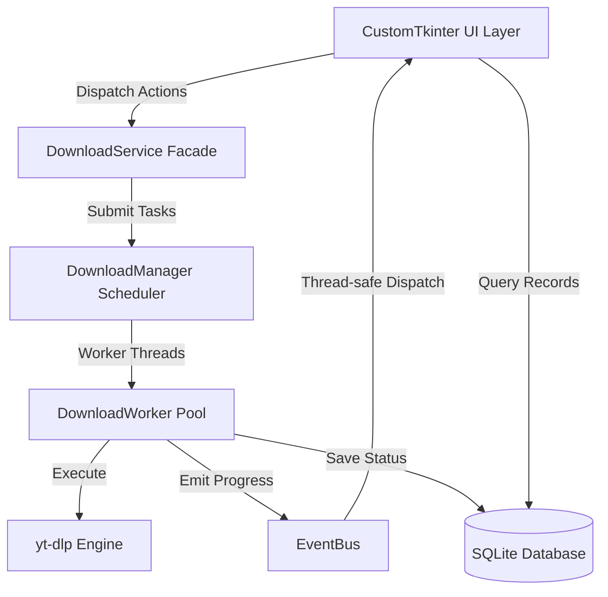

# yt-downloader

<div align="center">

[](https://www.python.org/)
[](LICENSE)
[](https://github.com/astral-sh/ruff)
[](https://www.microsoft.com/windows)
[](CONTRIBUTING.md)
[](https://github.com/anujkantx/yt-downloader/actions)

**A modern, high-performance Windows desktop video downloader powered by Python, CustomTkinter, and yt-dlp.**

[Key Features](#-features) •
[Quick Start](#-quick-start) •
[Architecture](#-architecture) •
[Development & Testing](#-development-setup) •
[Contributing](#-contributing) •
[License](#-license)

</div>

---

## 🚀 Overview

**yt-downloader** is a desktop application built to provide a modern, smooth, and freeze-free experience for downloading video and audio from YouTube and thousands of other video platforms. 

Built with **CustomTkinter** for a polished dark theme and **yt-dlp** for robust media extraction, it features an asynchronous architecture, multi-task queue scheduling, real-time speed metrics, 4K/UHD streams, audio conversion, and persistent SQLite history.

---

## ✨ Features

- **🎨 Modern Dark UI**: CustomTkinter-powered interface with a refined slate & indigo theme, rounded cards, and responsive navigation.
- **⚡ Asynchronous & Non-Blocking**: UI never freezes. Downloads and metadata queries run on background worker threads coordinated through a thread-safe event bus.
- **📋 Batch & Queue Management**: Paste single or multiple URLs (one per line) with automatic trimming, deduplication, and input validation.
- **🔍 Instant Metadata Preview**: Probes video title, channel, duration, and highest available source resolution before downloading.
- **🎬 Flexible Quality & Format Selection**:
  - **Video**: Best Available, 2160p (4K UHD), 1440p (2K QHD), 1080p (Full HD), 720p (HD), 480p, 360p.
  - **Audio & Containers**: MP4, MKV, MP3, M4A, or Original stream.
- **📊 Real-Time Metrics**: Live progress bar, download speed (e.g., `8.2 MB/s`), downloaded vs total file size, and ETA.
- **🔄 Task Controls**: Cooperative cancellation (cleanly deletes partial `.part` files), retry failed tasks, and clear completed items.
- **🗃️ Persistent SQLite History**: Keeps record of completed downloads with quick actions to play files, reveal in Windows Explorer, or re-download.
- **🛠️ Built-in FFmpeg Diagnostics**: Auto-detects system FFmpeg, bundled binaries, or custom user paths, with automatic fallbacks for pre-merged formats.
- **🛡️ Safe Windows Filesystem Handling**: Automatically cleans forbidden characters (`< > : " / \ | ? *`), handles reserved device names (`CON`, `PRN`), and prevents file overwrite collisions.

---

## 📥 Quick Start

### Option A: Install via Windows Installer (Recommended for Users)
1. Download the latest installer from the **[Releases](https://github.com/anujkantx/yt-downloader/releases)** page.
2. Run `VideoDownloader-Setup.exe` and follow the setup wizard.
3. Launch **yt-downloader** from your Start Menu or Desktop!

---

### Option B: Run from Source (For Developers)

#### 1. Clone the repository
```powershell
git clone https://github.com/anujkantx/yt-downloader.git
cd yt-downloader
```

#### 2. Create and activate a virtual environment
```powershell
python -m venv .venv
.\.venv\Scripts\Activate.ps1
```

#### 3. Install dependencies
```powershell
pip install -r requirements-dev.txt
```

#### 4. Launch the application
```powershell
python main.py
```

---

## 🏗️ Architecture

The project follows a clean, modular architecture separating UI, background workers, business services, and database persistence:



### Directory Structure

```text
yt-downloader/
├── main.py                     # Entry point & DPI awareness
├── app/
│   ├── application.py          # App coordinator & shutdown hooks
│   ├── core/                   # Download engine & queue management
│   │   ├── downloader.py       # yt-dlp wrapper & format resolution
│   │   ├── download_manager.py # Worker pool & concurrency controller
│   │   ├── download_worker.py  # Thread worker & rate-limited progress
│   │   ├── download_events.py  # Thread-safe EventBus
│   │   └── download_models.py  # Task & Progress data structures
│   ├── services/               # Core services
│   │   ├── download_service.py # UI service facade
│   │   ├── metadata_service.py # Asynchronous metadata inspector
│   │   ├── ffmpeg_service.py   # FFmpeg detection & diagnostics
│   │   └── file_service.py     # Safe file naming & Windows Explorer actions
│   ├── database/               # SQLite history
│   │   ├── database.py         # Connection manager & WAL mode
│   │   ├── repository.py       # Task CRUD operations
│   │   └── schema.sql          # DB schema & performance indexes
│   ├── config/                 # User settings
│   │   ├── settings.py         # SettingsManager with atomic saves
│   │   └── defaults.py         # Default options & format definitions
│   ├── ui/                     # Presentation layer
│   │   ├── main_window.py      # Window container & sidebar navigation
│   │   ├── downloads_page.py   # Main download view & active cards
│   │   ├── history_page.py     # Download history viewer
│   │   ├── settings_page.py    # Configuration & FFmpeg diagnostics
│   │   ├── about_page.py       # App info & legal notice
│   │   ├── theme.py            # Dark theme color palette
│   │   └── components/         # Reusable CustomTkinter widgets
│   └── utils/                  # Logging, paths, and validation helpers
├── assets/                     # Icons and bundled binaries
├── packaging/                  # PyInstaller spec & Inno Setup scripts
├── tests/                      # Automated pytest suite
└── .github/                    # CI workflows & issue/PR templates
```

---

## 🧪 Development Setup

### Running Tests
The project includes a comprehensive suite of unit and integration tests covering the queue manager, database persistence, URL validators, format selectors, and GUI initialization:

```powershell
pytest -v
```

### Code Formatting & Linting
We enforce clean, idiomatic Python using **Ruff**:

```powershell
# Check for lint issues
ruff check app tests

# Run format check
ruff format --check app tests
```

---

## 📦 Building Standalone Executable & Installer

To compile a standalone Windows `.exe` and an Inno Setup installer:

```powershell
powershell -ExecutionPolicy Bypass -File packaging/build_windows.ps1
```

- **Standalone Directory**: `dist\VideoDownloader\VideoDownloader.exe`
- **Installer Package**: `dist_installer\VideoDownloader-Setup.exe`

---

## 🤝 Contributing

Contributions are what make the open-source community such an amazing place to learn, inspire, and create! Any contributions you make are **greatly appreciated**.

Please read our [Contributing Guide (CONTRIBUTING.md)](CONTRIBUTING.md) for detailed instructions on:
1. Setting up your fork and local development branch
2. Coding standards and commit conventions
3. Writing tests and verifying quality
4. Submitting a Pull Request

Check out our [Good First Issues](CONTRIBUTING.md#good-first-issues--ideas) if you're looking for an idea to get started!

---

## 📜 Legal and Responsible Usage

This application is provided strictly for personal archival, research, and authorized educational use.

- Users are responsible for complying with the terms of service of media hosting platforms and applicable local copyright laws.
- This software does not bypass or circumvent Digital Rights Management (DRM) or access encrypted/paywalled content.

---

## 📄 License

Distributed under the **MIT License**. See [`LICENSE`](LICENSE) for more information.

---

<div align="center">
Made with ❤️ by <a href="https://github.com/anujkantx">Anujkant</a> and the open-source community.
</div>
